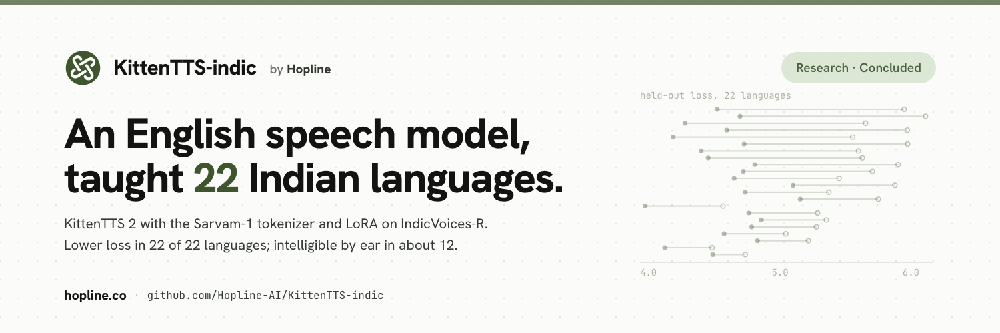

<p align="center"></p>

# KittenTTS-indic

This is a fork of [KittenTTS](https://github.com/KittenML/KittenTTS) by KittenML. We used it to
test whether KittenTTS 2, a 1.7B-parameter speech language model that mostly speaks English,
could learn 22 Indian languages. We made two changes: we swapped its text tokenizer for the
one from Sarvam-1, and we fine-tuned it with LoRA on IndicVoices-R (AI4Bharat), about 210
hours capped at 10 hours per language.

**Status:** concluded research experiment, kept for reference. It is not maintained, and we do
not plan to use the model. The full write-up is on the Hopline site:
[hopline.co/writing/kittentts-indic](https://hopline.co/writing/kittentts-indic).

## Results

We trained for 5 hours on one NVIDIA H200 on the eX3 research cluster on 17 October 2026, then
compared the fine-tuned model with the original KittenTTS 2 on held-out IndicVoices-R clips.

| Check | Result |
|---|---|
| Held-out audio-token loss (teacher-forced) | Lower than the original on 22 of 22 languages; mean drop 0.81, about 2.3x lower perplexity |
| Listening plus a Whisper transcript, 2 sentences per language | Intelligible in about 12 of 22 languages (6 newly, 6 the original already handled); partial in 4; failing in 6 |
| Speed on CPU (20 threads) | Real-time factor 2.439, with 13.5 s to first audio, so slower than real time |

Lower loss everywhere did not mean intelligible speech everywhere. The CPU speed is why we
stopped. Hopline needs speech on laptops and phones, and a 1.7B autoregressive model runs slower
than real time there. Merging LoRA also turns the weights into bf16 (about 3 GB), so the
fine-tuned model loses the 506 MiB ternary packing. The report has per-language numbers,
caveats and what we would do differently.

## Repository layout

| Path | What it is |
|---|---|
| `kittenml/` | The upstream KittenTTS library, with small Indic fixes: `kittentts2/text.py` treats the danda as a sentence end, `kittentts2/model.py` sizes chunks by seconds of audio per script and warns when bf16 is emulated, and `kittentts2/speaker.py` detects the reference clip's language |
| `indic/overnight/` | The pipeline we ran: IndicVoices-R fetch, shard preparation, Slurm stages and the baseline vs fine-tuned evaluation (`run.sh` is the entry point) |
| `indic/vocab/` | Sarvam-1 vocabulary swap on the checkpoint, and a check that the rebuilt checkpoint is correct |
| `indic/train/` | Training loop (LoRA, embedding and full modes), shard reader and a CPU self-check |
| `indic/bench/` | Benchmarks: tokenizer fertility, codec round trip, sequence format, GPU fit, CPU speed |
| `indic/eval/` | Evaluation harness: test sets, ASR, error rates and speaker similarity |
| `indic/hpc/` | Hardware detection, offline model staging and Slurm templates |
| `indic/preflight.py` | Runs the pre-training checks in order and writes `indic/data/PREFLIGHT_REPORT.md` |
| `indic/data/` | Measurement JSON files that the docs cite |
| `docs/indic/` | Plan, runbook, findings and research notes for the Indic work |
| `docs/` (other files), `example*.py`, `tests/` | Upstream KittenTTS documentation, examples and tests |

## Reproducing the run

You need a Slurm cluster with an NVIDIA GPU, a Hugging Face token that has accepted the
`ai4bharat/indicvoices_r` terms, and the models staged for offline compute nodes. The entry
point is `indic/overnight/run.sh`. The header of that script lists its settings, and
[indic/QUICKSTART.md](indic/QUICKSTART.md) and [docs/indic/RUNBOOK.md](docs/indic/RUNBOOK.md)
cover setup.

```bash
python -m venv .venv && .venv/bin/pip install -r requirements.txt
.venv/bin/pip install -r indic/requirements-hpc.txt

# Rehearsal on a laptop: synthetic data, CPU only, no network
DRY=1 TRAIN_MIN=1 DATA=/tmp/kindic PY=.venv/bin/python bash indic/overnight/run.sh

# Real run, from the cluster login node with the venv activated
export HF_TOKEN=... STAGED_HF_HOME=/path/to/staged/hf
bash indic/overnight/run.sh
```

The CPU self-check for the training loop needs no GPU and no download:

```bash
.venv/bin/python -m indic.train.selfcheck
```

## Using KittenTTS itself

For installing and using KittenTTS (built-in voices, voice cloning, expression tags, the ONNX
models, vLLM), see the upstream repository at
[github.com/KittenML/KittenTTS](https://github.com/KittenML/KittenTTS). The upstream docs are
also kept in [docs/](docs/README.md).

## Credits

- Bishwajeet Parhi and Khushiyant Chauhan of [Hopline](https://hopline.co), who did the Indic
  work in this fork.
- [KittenML](https://github.com/KittenML/KittenTTS) for KittenTTS and the KittenTTS 2 model.
- [AI4Bharat](https://huggingface.co/datasets/ai4bharat/indicvoices_r) for the IndicVoices-R dataset.
- [Sarvam AI](https://huggingface.co/sarvamai/sarvam-1) for the Sarvam-1 tokenizer.

## License

The code in this repository is under the [Apache License 2.0](LICENSE), as in upstream
KittenTTS. That license covers the code only.

Models and data have their own terms, and they may differ:

- KittenTTS 2 weights are released under the
  [Stellon Labs Community License](https://huggingface.co/KittenML/kitten-tts-2/blob/main/LICENSE.md).
  Check it before using the weights or anything derived from them, including a fine-tune.
- The `sarvamai/sarvam-1` tokenizer is under Sarvam's non-commercial license.
- IndicVoices-R is distributed by AI4Bharat under its own terms.

<div align="center"><a href="https://hopline.co"></a></div>
