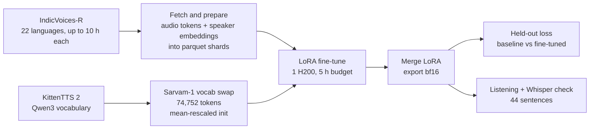

# KittenTTS-indic: final report

Bishwajeet Parhi and Khushiyant Chauhan, Hopline. Work done 16 and 17 October 2026.

> Status: concluded experiment, kept for reference. We are not using this model.

We took KittenTTS 2, a mostly English 1.7B-parameter speech model, and tried to teach it 22 Indian languages. We replaced its text tokenizer with the one from Sarvam-1 and ran a LoRA fine-tune for 5 hours on one NVIDIA H200, using up to 10 hours of IndicVoices-R speech per language. On held-out audio-token loss the fine-tuned model beat the original in 22 of 22 languages, with a mean drop of 0.81 (about 2.3× lower perplexity). When we listened to the output and ran it through Whisper, the picture was smaller: speech was intelligible in about 12 of the 22 languages, partly intelligible in 4, and not usable in 6. The model is still autoregressive at 1.7B parameters and runs slower than real time on CPU (RTF 2.439), which does not fit the edge hardware Hopline builds for. So the project is closed. This report records what we did, what came out, and what we would do differently.

## Contents

1. [What we set out to do](#what-we-set-out-to-do)
2. [Setup](#setup)
3. [How the gains were obtained](#how-the-gains-were-obtained)
4. [Results](#results)
5. [Limitations](#limitations)
6. [Why we are not using it](#why-we-are-not-using-it)
7. [Engineering notes](#engineering-notes)
8. [What we learned](#what-we-learned)
9. [Reproducing](#reproducing)
10. [Credits](#credits)

## What we set out to do

KittenML's KittenTTS 2 is a 1.7B-parameter autoregressive speech language model built on Qwen3. It ships with ternary ("1-bit") weights packed into 506 MiB, and it supports voice cloning and emotion control. Upstream it is mostly English.

The question was simple. Can a cheap intervention (a better tokenizer for Indic scripts plus a few hours of LoRA) move this model toward speaking the 22 scheduled Indian languages? We wanted a measured answer, so the pipeline ends in a per-language comparison against the unmodified model.

## Setup

### Base model and tokenizer swap

- Base: KittenTTS 2 (Qwen3 architecture, 28 layers, 1.7B parameters).
- Tokenizer: Sarvam-1's tokenizer replaced the original Qwen3 one. The vocabulary went from 158,237 to 74,752 tokens. Of those, 68,096 are Sarvam pieces. The new embedding rows were initialised by mean-rescaling.
- After merging the LoRA weights back in, the model has about 1.55B parameters.

### LoRA configuration

- Rank 64, alpha 128.
- Applied to all 7 projections in all 28 layers.
- Also trained: the embedding table, the norms and the speaker head.
- Trainable parameters: roughly 70M in LoRA plus roughly 153M in the new embedding table, about 225M in total. This is an estimate from tensor shapes, not a logged number.

### Data

IndicVoices-R from AI4Bharat, capped at 10 hours per language. That gives 22 languages, about 210 hours and 86,059 training clips (the sum of the table below). Held-out clips came from the IndicVoices-R test split, 15 to 24 per language.

| Code | Language | Hours | Train clips | Speakers |
|---|---|---:|---:|---:|
| as | Assamese | 10.0 | 4,289 | 468 |
| bn | Bengali | 10.0 | 3,798 | 470 |
| brx | Bodo | 10.0 | 4,623 | 401 |
| doi | Dogri | 10.0 | 3,970 | 299 |
| gu | Gujarati | 2.96 | 1,096 | 13 |
| hi | Hindi | 10.0 | 3,812 | 338 |
| kn | Kannada | 10.0 | 4,070 | 302 |
| kok | Konkani | 10.0 | 4,214 | 195 |
| ks | Kashmiri | 10.0 | 4,133 | 322 |
| mai | Maithili | 10.0 | 4,052 | 487 |
| ml | Malayalam | 10.0 | 4,073 | 366 |
| mni | Manipuri | 10.0 | 3,934 | 96 |
| mr | Marathi | 10.0 | 4,064 | 313 |
| ne | Nepali | 10.0 | 4,215 | 581 |
| or | Odia | 10.0 | 3,759 | 394 |
| pa | Punjabi | 10.0 | 3,841 | 295 |
| sa | Sanskrit | 10.0 | 4,192 | 128 |
| sat | Santali | 10.0 | 4,722 | 270 |
| sd | Sindhi | 7.73 | 3,076 | 172 |
| ta | Tamil | 10.0 | 4,114 | 712 |
| te | Telugu | 9.98 | 4,001 | 401 |
| ur | Urdu | 10.0 | 4,011 | 379 |

Gujarati is the outlier: under 3 hours from only 13 speakers. Sindhi also fell short of the cap.

### Compute and time budget

One NVIDIA H200 (the `h200q` partition) on the eX3 research cluster. Training was time-budgeted to 5 hours and ran on 17 October 2026.

## How the gains were obtained

The method has four parts.

1. Vocabulary swap. Qwen3's tokenizer splits Indic text into many small pieces. Sarvam-1's tokenizer was built for these scripts, so a sentence costs far fewer tokens. We rebuilt the model's shared vocabulary around Sarvam's pieces and kept the audio codec tokens and special markers. New text rows started from mean-rescaled embeddings, so the model did not begin from random vectors.
2. LoRA on every projection, plus the parts the swap touches. Because the embedding table is new, it has to learn. We trained it fully, along with the norms and the speaker head, and put LoRA adapters on all attention and MLP projections.
3. Balanced data. Each language was capped at 10 hours of IndicVoices-R so that no single language dominated.
4. A fixed time budget. Training stopped at 5 hours rather than at a target loss or epoch count.

The whole thing runs as one overnight pipeline on the cluster:

## Results

### Held-out audio-token loss

This is teacher-forced loss on the audio tokens of held-out clips: how well each model predicts the real recording given its text. Lower is better. Both models are scored on the same audio targets, each through its own tokenizer.

| Lang | n | Baseline | Fine-tuned | Change | Perplexity ratio |
|---|---:|---:|---:|---:|---:|
| as | 24 | 5.914 | 4.621 | -1.294 | 3.65× |
| bn | 24 | 5.891 | 4.553 | -1.338 | 3.81× |
| brx | 24 | 5.825 | 5.096 | -0.729 | 2.07× |
| doi | 24 | 5.263 | 4.799 | -0.464 | 1.59× |
| gu | 24 | 5.706 | 5.147 | -0.560 | 1.75× |
| hi | 21 | 4.753 | 4.521 | -0.232 | 1.26× |
| kn | 24 | 5.916 | 4.745 | -1.171 | 3.22× |
| kok | 18 | 5.271 | 4.779 | -0.492 | 1.64× |
| ks | 24 | 5.425 | 4.674 | -0.751 | 2.12× |
| mai | 24 | 5.205 | 4.841 | -0.364 | 1.44× |
| ml | 24 | 6.044 | 4.716 | -1.328 | 3.77× |
| mni | 24 | 5.523 | 4.237 | -1.286 | 3.62× |
| mr | 21 | 5.044 | 4.602 | -0.442 | 1.56× |
| ne | 24 | 5.352 | 4.753 | -0.599 | 1.82× |
| or | 24 | 5.848 | 4.822 | -1.026 | 2.79× |
| pa | 21 | 5.591 | 4.488 | -1.104 | 3.02× |
| sa | 21 | 4.516 | 4.177 | -0.339 | 1.40× |
| sat | 15 | 5.564 | 4.438 | -1.126 | 3.08× |
| sd | 24 | 4.594 | 4.037 | -0.557 | 1.75× |
| ta | 24 | 5.663 | 4.739 | -0.924 | 2.52× |
| te | 21 | 5.615 | 4.321 | -1.294 | 3.65× |
| ur | 18 | 5.334 | 4.869 | -0.464 | 1.59× |
| Mean | 492 total | 5.448 | 4.635 | -0.81 | about 2.3× |

The fine-tuned model is lower on every language. The smallest gain is Hindi (-0.232), which fits: the baseline already speaks Hindi. The largest gains are in Bengali, Malayalam, Assamese, Telugu and Manipuri, all above 1.28.

We expected the six languages where Sarvam falls back to bytes (Urdu, Sindhi, Kashmiri, Santali, Manipuri, Assamese) to lag. On loss they did not. They improved by 0.91 on average against 0.78 for the rest.

### Listening and Whisper check

Loss tells you whether the model predicts real recordings better. It does not tell you whether a person can understand what it says. So we generated 44 sentences (2 per language) with both models. Each pair used the same held-out sentence and the same cloned voice, with another held-out clip of that language as the voice reference. We transcribed all 88 clips with Whisper large-v3-turbo, without forcing a language, and listened to them.

Whisper often wrote the right sounds in the wrong script: Bengali in Gujarati letters, Kannada in Tamil letters. We therefore judged by content, not by the language label Whisper picked. This is an informal check, not a character-error-rate benchmark.

What the baseline did. KittenTTS 2 already speaks Hindi well. Both Hindi sentences came back almost word for word, for example "क्योंकि मेरे घर में कुछ लोग को चाय पसंद है और कुछ लोग को कौफी पीना पसंद है". It partly handled other Devanagari languages (Marathi, Maithili, Nepali, one Urdu sentence). Elsewhere it produced fillers, guesses in the wrong language, or repetition. Both Bengali clips transcribed as "Thank you." Several clips were under one second long.

What the fine-tuned model did, grouped by language:

| Category | Count | Languages |
|---|---:|---|
| Newly intelligible (baseline was not) | 6 | Bengali, Gujarati, Tamil, Kannada, Odia (1 of 2 clips), Urdu (1 of 2 clips) |
| Good, but the baseline was already decent | 6 | Hindi, Marathi, Maithili, Nepali, Sanskrit, Sindhi |
| Partial or unclear | 4 | Kashmiri, Punjabi, Konkani, Dogri |
| Not intelligible | 5 | Telugu, Malayalam, Assamese, Manipuri, Santali |
| Repetition, runaway output | 1 | Bodo (both clips loop one syllable) |

One Urdu clip also ran away: 40 seconds of audio for one sentence.

Two examples from the transcripts. For the second Gujarati sentence, the baseline transcript was the single word "clear". The fine-tuned transcript was "પાટળ મેસાણા વળોદ્રા અમધાવાદ અને ગાંથિનગર". For the first Bengali sentence, the baseline gave "Thank you." and the fine-tuned model gave Bengali speech that Whisper wrote in Gujarati script: "તારા આમાકે જોત્તન સહોકારેર હાતે ધોરે શીકીએ દેન આમી બારીતે એસે શેસબ રોજ પાતકીસ કરી".

Among the 14 languages Whisper supports, it detected the correct language on 7 of 28 fine-tuned clips and 2 of 28 baseline clips. Given the script confusion above, that is a weak signal.

Neither model clipped. Fine-tuned durations were more plausible, 2.5 to 10 seconds for full sentences, but some clips were cut short: Punjabi, Dogri, Manipuri and Konkani came out at about 1.2 to 1.6 seconds.

### Success rate

Stated plainly:

- On held-out loss: 22 of 22 languages improved.
- By ear: about 12 of 22 are intelligible. Six of those are new (Bengali, Gujarati, Tamil, Kannada, Odia, Urdu, the last two on one clip of two). The other six were already decent before fine-tuning (Hindi, Marathi, Maithili, Nepali, Sanskrit, Sindhi).
- 4 of 22 are partial.
- 6 of 22 are not usable: 5 unintelligible, plus Bodo, which loops.

The gap between 22 and 12 is the main finding of the evaluation. Loss measures how well the model predicts the next audio token when it is fed the real recording. Generation has no real recording to lean on. The model feeds on its own output, and small errors compound into wrong words, repeated syllables or clips that stop early. A lower loss means the model moved in the right direction. It does not mean it crossed the line where a listener understands it. For about half the languages it did not, at least not in 5 hours on this data.

So the net count of what the fine-tune added is 6 languages that became intelligible, out of 16 that were not intelligible before.

### Training stats

| | |
|---|---|
| Steps | 19,470 in 5.0 h (time-budgeted) |
| Batch size | 16 |
| Learning rate | 1e-4 body, 3e-4 embeddings, 200 warmup steps |
| Memory saving | gradient checkpointing |
| Loss | 8.602 (average of first 20 steps) to 4.244 (average of last 20) |
| Throughput | median 7,637 tokens/s |
| Peak GPU memory | 33.5 GB |
| Padding | 25% to 41% of every batch |
| Export | merged LoRA, bf16, about 3 GB |

The padding number deserves attention. Batches were drawn at random and mixed short and long clips with no length bucketing, so between a quarter and two fifths of every batch was padding.

## Limitations

- The evaluation is in-domain. Training and held-out clips both come from IndicVoices-R. We have no out-of-domain test.
- Held-out sets are small, 15 to 24 clips per language. Per-language loss numbers would move with a different sample.
- The listening check is informal. It covers 2 sentences per language, judged by us with Whisper as a helper. It is not a CER or MOS benchmark.
- Bodo loops on both clips, and one Urdu clip ran for 40 seconds for a single sentence.
- Padding took 25% to 41% of each batch. That is GPU time spent on nothing.
- The ternary packing is gone. KittenTTS 2 ships at 506 MiB. Our merged export is bf16 at about 3 GB.
- Gujarati had under 3 hours of data from 13 speakers, so its numbers rest on much less than the others.

## Why we are not using it

The reasons are practical. They are about fit with what Hopline builds, not a verdict on the experiment.

- Speed. KittenTTS 2 is autoregressive at 1.7B parameters. The repo's own benchmark measured RTF 2.439 on CPU with 20 threads, and 13.5 seconds to first audio. That is slower than real time. Hopline targets edge hardware: laptops, phones, 2 to 6 GB of RAM, GTX 1650-class GPUs.
- Size. After merging LoRA the weights are bf16 at about 3 GB. The 506 MiB ternary packing no longer applies.
- Existing open models. Two open models aimed at this exact problem already exist. We have not benchmarked either of them.
  - Indic-Mio (SPRINGLab, Apache-2.0): about 0.6B parameters, Qwen3 plus MioCodec, all 22 languages plus English, trained on Rasa, zero-shot voice cloning, with community GGUF, MLX and LiteRT ports.
  - DhVaani-0.5 (ARTPARK-IISc, Apache-2.0): 123M parameters, ZipVoice flow matching, 27 languages, zero-shot voice cloning.

We are closing the project as a learning exercise and keeping the code and this report for reference.

## Engineering notes

Problems we hit on 16 and 17 October 2026, and how they were fixed:

1. Gaps in the fork. An audit found no training entry point, no export or LoRA merge, no resume after a Slurm requeue, an epoch counter that never advanced, and no check that shards and checkpoint used the same tokenizer. All five were fixed.
2. eX3 Slurm details. GPUs have to be requested by GRES. The `--mem` flag had to go, because nodes advertise `RealMemory=1`.
3. The first overnight run failed at the Sarvam vocabulary build. Jobs on the cluster have no internet, and the code tried an offline Hub lookup. Fixed by resolving staged models by path.
4. eX3 refused to mmap the 3.5 GB bf16 safetensors file (ENOMEM) on both login and compute nodes. Fixed with a plain-read safetensors loader and by lifting the address-space limit inside jobs.
5. We resubmitted with `RESUME=1`, which skips fetch and prepare. Training and evaluation then ran clean.

Most of these come from moving a laptop-tested pipeline onto a shared cluster. The `DRY=1` rehearsal mode and the smoke test at the start of `run.sh` are there so that failures like these show up in minutes instead of at 3 am.

## What we learned

- A tokenizer swap plus 5 hours of LoRA does move a mostly English 1.7B speech model toward 22 Indic languages in a measurable way. Loss improved everywhere. Intelligibility improved in roughly half.
- Loss is not intelligibility. 22 of 22 on loss turned into about 12 of 22 by ear, and 6 of those 12 were already there before we started.
- Data quality matters. IndicVoices-R is mostly spontaneous speech. AI4Bharat's Rasa (about 50 hours of studio speech per language, all 22 languages, CC-BY-4.0) is the better source for TTS.
- Decide the deployment target before the training run. The edge requirement ruled out this architecture, and we only applied it after the model was trained.
- Cheap evaluation gates, listening plus ASR, should run before a long training job, not after it.
- Length bucketing would have saved roughly a third of the GPU time we lost to padding.

## Reproducing

The pipeline lives in this repository. All paths below are relative to the repo root.

- `indic/overnight/run.sh`: one command on the eX3 login node. Runs pre-flight checks and a smoke test, starts the IndicVoices-R downloads, runs the Sarvam vocabulary swap on a compute node, then submits the prepare, train and eval jobs as a chain.
  - `DRY=1 DATA=/tmp/k bash indic/overnight/run.sh` rehearses the whole thing on a laptop with no GPU and no network.
  - `RESUME=1 bash indic/overnight/run.sh` skips fetch and prepare when the shards already exist.
  - Knobs are environment variables: `ARM`, `HOURS`, `TRAIN_MIN`, `BATCH`, `PART`, `LANGS`, `DATA`.
- `indic/overnight/stage.sh`: one stage of the pipeline (`prepare`, `train` or `eval`), run by `indic/overnight/stage.sbatch` on a GPU node. It holds the exact training flags used for this run.
- `indic/vocab/build_sarvam_vocab.py`: the vocabulary swap (`--init mean_rescaled`).
- `indic/overnight/fetch.py` and `indic/overnight/prepare.py`: download IndicVoices-R and turn it into parquet shards.
- `indic/train/loop.py`: the training loop (`--mode lora`, with `--lora-rank` and `--lora-alpha`), checkpointing, resume and export.
- `indic/overnight/evaluate.py`: baseline vs fine-tuned held-out loss per language. Writes `REPORT.md` into the data directory.

Background and the earlier measurements (tokenizer fertility, codec round-trip, memory fit) are in `docs/indic/2026-10-16-findings-and-decisions.md`. The CPU speed analysis is in `docs/indic/PLAN.md`.

You will need a Hugging Face token with the IndicVoices-R terms accepted, and the KittenTTS 2 and Sarvam-1 snapshots staged locally if your jobs have no internet.

## Credits

Built by Hopline's two founders, with equal credit:

- Bishwajeet Parhi ([@2002Bishwajeet](https://github.com/2002Bishwajeet)): the Slurm and HPC pipeline, the overnight chain from IndicVoices-R fetch to shards to Sarvam LoRA fine-tune to the baseline-vs-fine-tuned report, the training fixes (entry point, export, requeue resume, epoch handling, tokenizer guard), throughput logging, and the runs on eX3.
- Khushiyant Chauhan ([@Khushiyant](https://github.com/Khushiyant)): the Indic research harness, the language table and tokenizer fertility benchmark, the ternary quantizer analysis and GPU fit probe, the codec round-trip and sequence-format gates, the Sarvam vocabulary surgery and its verification, the self-validating training pipeline, the Indic evaluation harness, the HPC portability layer and Slurm templates, the preflight orchestrator, the shard reader, chunking by seconds of audio per script, and the findings, decisions and CPU plan documents (`docs/indic/PLAN.md`).

Thanks to:

- KittenML for KittenTTS 2, the upstream model this fork is built on.
- AI4Bharat for the IndicVoices-R dataset.
- Sarvam AI for the Sarvam-1 tokenizer.
- The eX3 research cluster for the compute.
